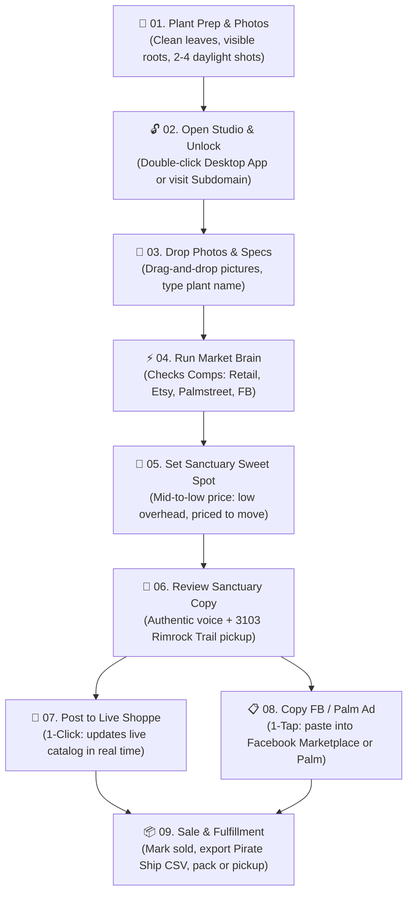

# The Magic Walnut Plant Shoppe — Sanctuary Listing Field Manual & Checklist

> [!NOTE]
> **Core Purpose**: A complete, repeatable "checkbook" style checklist to take any plant from raw leaf to listed, priced, published, and sold — with zero code, zero terminal commands, and zero guesswork.

---

## Visual Workflow Diagram

---

## Phase 1: Physical Prep & Photo Intake (The Green Work)

- [ ] **Step 1: Inspect the Plant**
  - Check that foliage is clean and free of dust or water spots.
  - Verify roots are visible through clear cup/pot or securely tucked in house chunky aroid mix.
  - Count active leaves, new growth points, or unfurling spears.

- [ ] **Step 2: Snap 2 to 4 Good Daylight Photos**
  - **Shot 1 (Hero)**: Full plant portrait showing leaf silhouette and balance.
  - **Shot 2 (Variegation/Detail)**: Close-up of the best leaf (white marble, pink splash, mint, or vein contrast).
  - **Shot 3 (Roots)**: Clear view of root health and chunkiness of the medium.
  - **Shot 4 (Growth Point)**: Active axillary bud or emerging growth spike.
  > [!TIP]
  > Natural, indirect window light works best. Avoid phone flashes that wash out white variegation.

---

## Phase 2: Opening the Studio (Zero Terminal Needed)

- [ ] **Step 3: Open the Listing Studio**
  - **On your AtomMan PC**: Double-click the **The Magic Walnut - Listing Studio** icon on your Desktop.
  - **On your phone / tablet**: Open your browser to `themagicwalnutplantshoppe.com/studio/` (or `studio.themagicwalnutplantshoppe.com`).

- [ ] **Step 4: Unlock the Dispatcher**
  - Enter your sanctuary passcode: `walnut2026`
  - Click `[ unlock studio ]`.
  - *(Your browser will remember your login on that device so you don't need to retype it every time).*

---

## Phase 3: Plant Specs & Intake

- [ ] **Step 5: Drop the Photos**
  - Drag and drop your plant photos directly onto the box, or tap it to open your phone camera roll.
  - Thumbnails will instantly appear. Tap the little `×` on any image if you want to remove it.

- [ ] **Step 6: Enter the Plant Name**
  - Type the common name (e.g., `Monstera Albo`, `Thai Constellation`, `Pink Princess`, `White Knight`, `Florida Beauty`, `Anthurium Clarinervium`).
  - *The studio automatically fills the botanical classification and category for you.*

- [ ] **Step 7: Check the Specs**
  - **Pot Size**: Default is `4" chunky mix` (or edit to `3.5" cup`, `starter plug`, etc.).
  - **Root Status**: Default is `established in chunky mix`.
  - **Light**: Default is `bright indirect`.
  - **Sanctuary Badge**: Select `[ 1-of-1 plant ]`, `[ high variegation ]`, `[ top cutting ]`, etc.

---

## Phase 4: Run the Market Brain & Pick Your Price

- [ ] **Step 8: Click `[ ⚡ analyze market comps & price ]`**
  - The brain analyzes current pricing across 4 major channels:
    - **Commercial Retail / Big Nursery**: High overhead prices (\$120–\$180).
    - **Etsy Nursery Avg**: Mid-to-high collector prices (\$85–\$140).
    - **Palmstreet / Whatnot**: Fast-paced live stream bids (\$60–\$100).
    - **Local FB Marketplace**: San Antonio area local prices (\$50–\$85).

- [ ] **Step 9: Confirm Your Sanctuary Sweet Spot**
  - **Pricing Strategy**: Mid-to-low range. Because you have low overhead and no commercial storefront rent, you price to move fast and give everyday plant lovers a fair deal.
  - Review the green **Recommended Sanctuary Price** (e.g. `\$58` or `\$75`).
  - Keep the recommendation or adjust the number to whatever price you want.

---

## Phase 5: Authentic Copywriting & Local Pickup

- [ ] **Step 10: Review the Auto-Generated Copy**
  - Written in your authentic website tone:
    > *"we just like dope ass plants. exact 1-of-1 plant pictured. authentic sectorial white marble variegation with high chlorophyll balance. active growth point established in our house chunky aroid bark mix. potted in 4\" cup. grown with love in our san antonio home sanctuary."*
  - Feel free to add any custom notes directly in the box.

- [ ] **Step 11: Verify the Local Pickup Checkbox**
  - Keep **`attach local pickup line`** checked so cross-listings automatically include:
    > `📍 Pick up near 3103 Rimrock Trail, San Antonio, TX 78251`

---

## Phase 6: Publish Live & Cross-List in 1 Tap

- [ ] **Step 12: Post to Live Website**
  - Click **`[ 🚀 post to live shoppe ]`**.
  - That's it! The plant is immediately inserted at the top of your live shop catalog.

- [ ] **Step 13: Cross-List to Facebook / Palmstreet (Optional)**
  - Click **`[ 📋 copy fb / palm ad ]`**.
  - Everything (title, botanical name, price, specs, description, WYSIWYG guarantee, and 3103 Rimrock pickup address) is copied to your clipboard.
  - Open Facebook Marketplace or Palmstreet and simply press **Paste** (`Ctrl + V`).

---

## Phase 7: Order Management & Fulfillment

- [ ] **Step 14: When a Plant Sells**
  - In the Studio, scroll down to the **Live Shoppe Inventory Manager** table.
  - Find the plant and click **`[ mark sold ]`**.
  - The website instantly shows the red **`SOLD`** badge and archives it so customers know it has been claimed.

- [ ] **Step 15: Packing & Shipping**
  - **If Local Pickup**: Coordinate pickup near 3103 Rimrock Trail.
  - **If Shipped**:
    - Tap **`[ pirate ship export ]`** on the order screen to get your 1-click shipping label CSV.
    - Wrap the nursery cup with polyfill/moss and tape securely.
    - Add thermal bubble wrap and a 72-hour UniHeat pack if transit temperatures drop below 45°F.
    - Drop off at USPS / UPS.

- [ ] **Step 16: Backup / Sync Catalog**
  - Once a week, click **`[ 💾 export catalog.json ]`** in the studio to download a fresh backup copy of your catalog.
